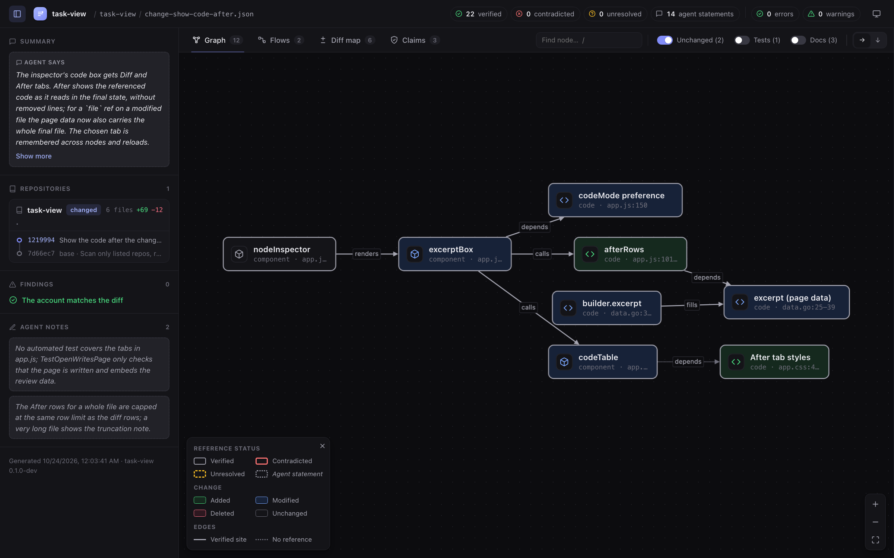
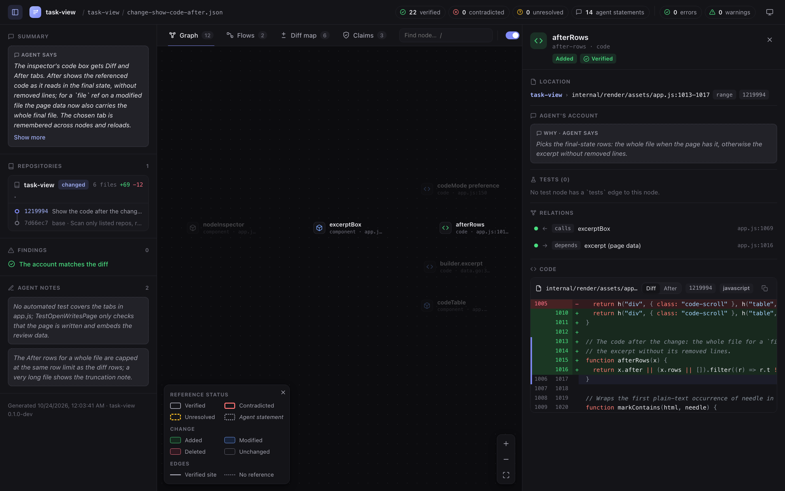
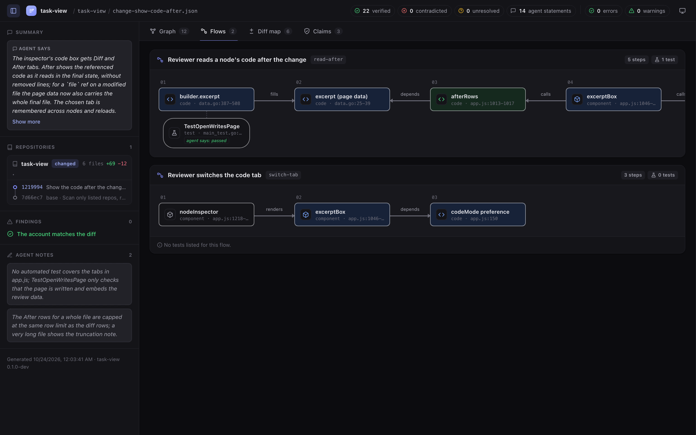
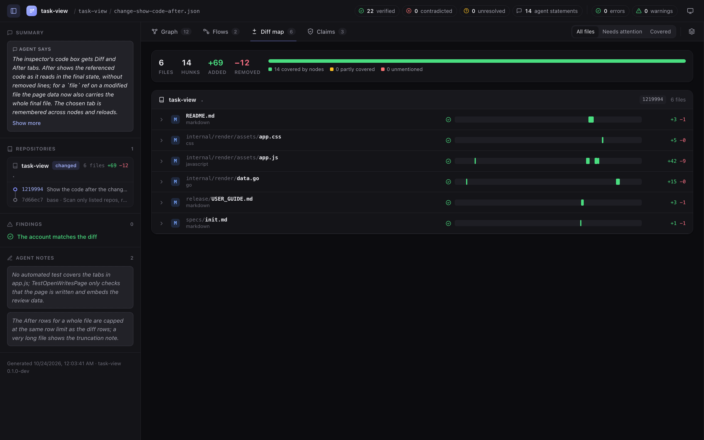
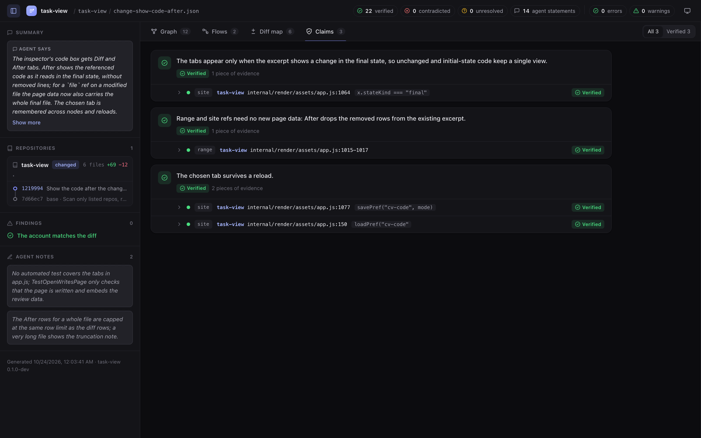
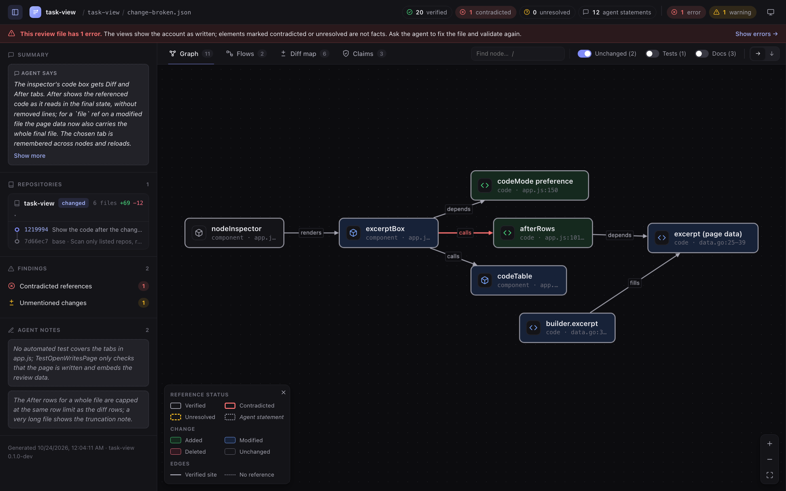
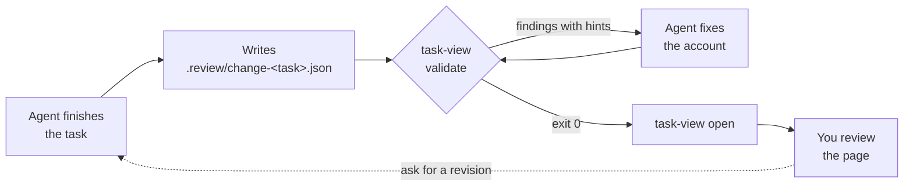

# task-view

**Review an agent's change as a map of how it fits together, not as a flat
list of diffs.**

When a coding agent writes most of the code, reviewing it means opening the
changed files in your IDE one by one and rebuilding in your head what calls
what, which path a request now takes, and which test covers which piece. The
diff shows lines; the structure of the change is left for you to work out.

`task-view` puts that structure on the page for you. When the agent finishes
a task, it describes its change: the functions, components and tests it
touched, why, how they relate, and the user-visible flows they form.
`task-view` turns that into one page you read in the browser: a graph of the
change, its flows step by step, and each piece's code next to the agent's
reason for it. You spend your attention judging the code, not reconstructing
it.



## What you get

- **The relations, already drawn.** Changed functions, components, endpoints
  and tests as a graph, across repos, so you see what connects to what
  without holding it in your head.
- **Flows, step by step.** Each path through the change from entry point to
  boundary, with the tests that exercise it attached to the steps they
  cover.
- **Code in context.** Click any piece to read its diff, or the code as it
  reads after the change, next to why the agent changed it and what it
  relates to.
- **A map you can trust.** Every file, line and commit the agent points at is
  checked against Git, and the diff map flags changed lines the agent didn't
  describe, so the map matches the real diff. Whether the code is right is
  still your call: test results and explanations are shown as the agent's
  word.
- **One offline HTML file per task** that you can keep or share. Building it
  only reads files and runs read-only Git; it never runs your tests, builds
  or other tooling.
- **Works with any programming language.** Nothing is parsed: the map is
  built from files, line ranges and diffs, so it fits Go, TypeScript,
  Python, Rust, SQL, config or infrastructure code alike, and changes that
  span several languages and repos (a web client and its API, say).
  Syntax highlighting covers about 300 languages; anything else shows as
  plain text.
- **Works with any coding agent** that can follow written instructions:
  Claude Code, Codex, and others.

## Install

`task-view` installs for your user only: no `sudo` or administrator rights.
The only runtime dependency is `git`.

**macOS and Linux:**

```bash
curl -fsSL https://raw.githubusercontent.com/gtindo/task-view/main/scripts/install.sh | sh
```

**Windows (PowerShell):**

```powershell
irm https://raw.githubusercontent.com/gtindo/task-view/main/scripts/install.ps1 | iex
```

The scripts ([install.sh](scripts/install.sh), [install.ps1](scripts/install.ps1))
pick the binary for your system and CPU from the latest release, check it
against the release checksums, install it in `~/.local/bin` (or
`%LOCALAPPDATA%\Programs\task-view` on Windows), clear the macOS quarantine
flag and add the folder to your `PATH` if needed. Open a new terminal
afterwards; run the same command again to update. The
[user guide](docs/USER_GUIDE.md#1-install) shows how to pin a version or
read the script before running it.

### Other ways to install

- **Manual download.** Get the file for your machine from the
  [latest release](https://github.com/gtindo/task-view/releases/latest)
  (`task-view-darwin-arm64`, `task-view-darwin-amd64`,
  `task-view-linux-amd64`, `task-view-linux-arm64` or
  `task-view-windows-amd64.exe`), rename it `task-view` (`task-view.exe` on
  Windows) and put it in a folder on your `PATH`. The
  [user guide](docs/USER_GUIDE.md#manual-download) has the exact commands.
- **With Go:** `go install github.com/gtindo/task-view/cmd/task-view@latest`,
  or `make install` from a checkout.

## Quick start

1. **Install `task-view`** (above) and **teach your agent the format** once,
   in one of the three ways below.
2. **Give the agent a task.** When it is done, it writes
   `.review/change-<task>.json` and checks it with `task-view validate` until
   the account holds.
3. **Open the review** with the command the agent gives you:

   ```bash
   task-view open .review/change-<task>.json
   ```

   If something looks wrong, ask the agent to revise the code or the account
   and run `open` again.

### Teach your agent: as a skill (recommended)

[`skills/task-review/SKILL.md`](skills/task-review/SKILL.md) is a ready-made
skill. It tells the agent to run `task-view instructions` when it finishes a
task and follow what it prints, so the instructions always match the installed
binary. For Claude Code, copy it into the repo, or into `~/.claude/skills/`
for every repo:

```bash
mkdir -p .claude/skills/task-review
curl -fsSL https://raw.githubusercontent.com/gtindo/task-view/main/skills/task-review/SKILL.md -o .claude/skills/task-review/SKILL.md
```

Any agent that reads skills (a `SKILL.md` with `name` and `description` front
matter) takes the same file. It is also attached to every release.

### Or: as a context file

Write the instructions into the repo and point your agent's context file at
them:

```bash
task-view instructions > TASK_REVIEW.md
```

Then add one line to that repo's `AGENTS.md` (Codex and most agents) or
`CLAUDE.md` (Claude Code):

```markdown
When you finish a task, follow TASK_REVIEW.md.
```

Refresh the file after upgrading `task-view`.

### Or: as a one-off prompt

No setup at all: end your task prompt with

> When you're done, run `task-view instructions` and write a review file for
> this task.

The same works for work that is already committed:

> Run `task-view instructions` and write `.review/change-<name>.json` for
> commit `<sha>`. Don't change any code.

## The page

The page shows the same change four ways (Graph, Flows, Diff map, Claims),
with an inspector for any piece you click. Each element also shows whether
its pointer into the code holds, so you know which parts of the map are
grounded in the real diff and which rest on the agent's word:

| Status | Look | Meaning |
| --- | --- | --- |
| Verified | Solid border, green check | The reference resolved and matches the files and the diff |
| Contradicted | Red border, red ✕ | The reference resolved but the check failed: wrong lines, wrong change state, text not on that line |
| Unresolved | Amber dashed border, ? | The file, line range or commit could not be found |
| Agent statement | Dotted gray border, italic | Nothing to check: no reference, or the agent's own explanation |

The fill shows the change itself: green **added**, blue **modified**, red
**deleted**, outline only for **unchanged**. The side panel always shows the
agent's summary, each repo's commits from base to final state, the findings
and the agent's notes.

The screenshots below are a real review of one commit of this repository,
described by an agent.

### Graph

The whole change at a glance (top of this page): source-code nodes grouped by
repo, endpoints between repos. Tests, docs and unchanged nodes sit behind the
toolbar switches. Search with `/`, click a node to focus on it and its
neighbours.

### Inspector

Click any node, edge, hunk or finding to open it on the right: where it is,
why it changed in the agent's words, which tests cover it, how it relates to
other nodes, and its code. The code box switches between **Diff** (changed
lines with what they replaced) and **After** (the code as it reads after the
change).



### Flows

One lane per user- or caller-visible path through the change, left to right,
with the tests that exercise it hanging under the steps they cover.



### Diff map

Every changed file with a bar of its hunks, colored by whether a node
describes them: green covered, amber partly covered, red not mentioned at
all. This is where you check that nothing was left out.



### Claims

Statements a reviewer might doubt ("the tab survives a reload"), each with the
evidence it rests on. Expand a piece of evidence to see the exact code or
commit it points at.



### When the account is wrong

If the review file still has errors, the page says so in a red banner, and
the findings in the side panel list what does not hold: here an edge that
points at text missing from its line, and changed CSS lines that no node
mentions.



## Guides

| Guide | For | What it covers |
| --- | --- | --- |
| [docs/USER_GUIDE.md](docs/USER_GUIDE.md) | You, the reviewer | Install, daily workflow, reading every part of the page, findings, keyboard, exit codes, troubleshooting |
| [docs/TASK_REVIEW.md](docs/TASK_REVIEW.md) | The agent | The review file format and the step-by-step procedure; the same text `task-view instructions` prints |
| [skills/task-review/SKILL.md](skills/task-review/SKILL.md) | The agent | The procedure packaged as a skill |
| [specs/init.md](specs/init.md) | Contributors | The full specification: schema, checks, findings and views |

## Commands

| Command | What it does |
| --- | --- |
| `task-view validate <file> [--format text\|json] [--scan-siblings]` | Schema, commit chain, reference and diff-level checks. Exit 0 ok, 1 contradicted/unresolved refs, 2 invalid file, 3 environment error |
| `task-view open <file> [--out <path>] [--no-browser] [--scan-siblings]` | Same checks, then writes one offline HTML page (default `generated/<name>.html` next to the review file) and opens it. Exit 1 still renders the page, with a red banner |
| `task-view schema` | JSON Schema of the review file |
| `task-view languages` | Valid language names and their usual file patterns |
| `task-view instructions` | The agent instructions for this binary's schema version |
| `task-view version` | Binary and supported schema versions |

Only the repos listed in the review file are read. `--scan-siblings` also
looks at the folders next to them and warns (`unlisted_repo`) about Git repos
with uncommitted changes that the review doesn't list.

## How it works



1. **The agent writes an account.** `.review/change-<task>.json` lists the
   repos and commits it covers, one node per meaningful piece of the change
   (a function, a component, a config block, a test case), the edges between
   them, the flows they form, and claims, each pointing at exact lines or
   commits.
2. **The agent validates it.** `task-view validate --format json` checks the
   schema, the commit chain, every reference and the diff coverage. Each
   error or warning carries a hint written for the agent to act on (a wrong
   line range, text not on that line, changed lines no node describes), and
   the agent repeats until the file validates.
3. **You open it.** `task-view open` runs the same checks, reads only the
   repos listed in the file, and writes the page to
   `.review/generated/change-<task>.html`. Each task keeps its own file, so
   earlier reviews stay in `.review/`.

These checks exist so the map you read matches the real diff. They say
nothing about whether **the work is good**: that is what the page helps you
judge. The tool reads files and runs a short list of read-only Git commands;
a test result on the page is always the agent's word.

## Development

```bash
make test    # unit tests and golden tests on generated fixture repos
make build   # bin/task-view
make check   # vet, lint (golangci-lint, ESLint via npx) and test
```

Code rules and package boundaries are in [AGENTS.md](AGENTS.md).

Layout: `cmd/task-view` (CLI), `internal/review` (model, embedded JSON
Schema, structural rules), `internal/engine` (Git states, diff, reference and
coverage checks), `internal/render` (view data and the embedded page:
`assets/app.js`, `assets/app.css`, vendored Cytoscape.js + ELK),
`internal/langs` (Chroma lexers and highlighting), `internal/instructions`
(`TASK_REVIEW.md`), `internal/fixture` (test repos), `scripts/` (the install
scripts), `skills/` (the agent skill), `docs` (the user guide, screenshots and a copy of `TASK_REVIEW.md`
regenerated by `make docs`).

Golden output for the accurate fixture review lives in
`cmd/task-view/testdata/valid.golden.json`; refresh it with `make golden`.

### Releasing

Releases are built by [`.github/workflows/release.yml`](.github/workflows/release.yml)
only when a version tag is pushed; pushes to `main` never build one. The
workflow runs vet and tests, then `make release` for Linux (amd64, arm64),
Windows (amd64) and macOS (Intel, Apple silicon), and publishes the binaries,
`SHA256SUMS`, the guides and the skill as a GitHub release. Tags with a
suffix (`v0.2.0-rc.1`) are marked as pre-releases.

```bash
git tag v0.2.0
git push origin v0.2.0
```

`make release VERSION=0.2.0` builds the same `release/` folder locally.

## Contributing

`task-view` is a personal tool and a raw idea, built in a day. I don't accept
issues or pull requests. If it fits most of your workflow but you want
something different, fork it: the specification ([specs/init.md](specs/init.md)),
code rules ([AGENTS.md](AGENTS.md)) and golden tests are there so your own
agent can reshape it safely.

## License

`task-view` is released under the [MIT License](LICENSE). The page embeds
Cytoscape.js and cytoscape-elk (MIT) and ELK (Eclipse Public License 2.0);
their licenses are in
[internal/render/assets/vendor/LICENSES.txt](internal/render/assets/vendor/LICENSES.txt)
and ship with every release as `THIRD_PARTY_LICENSES.txt`.
