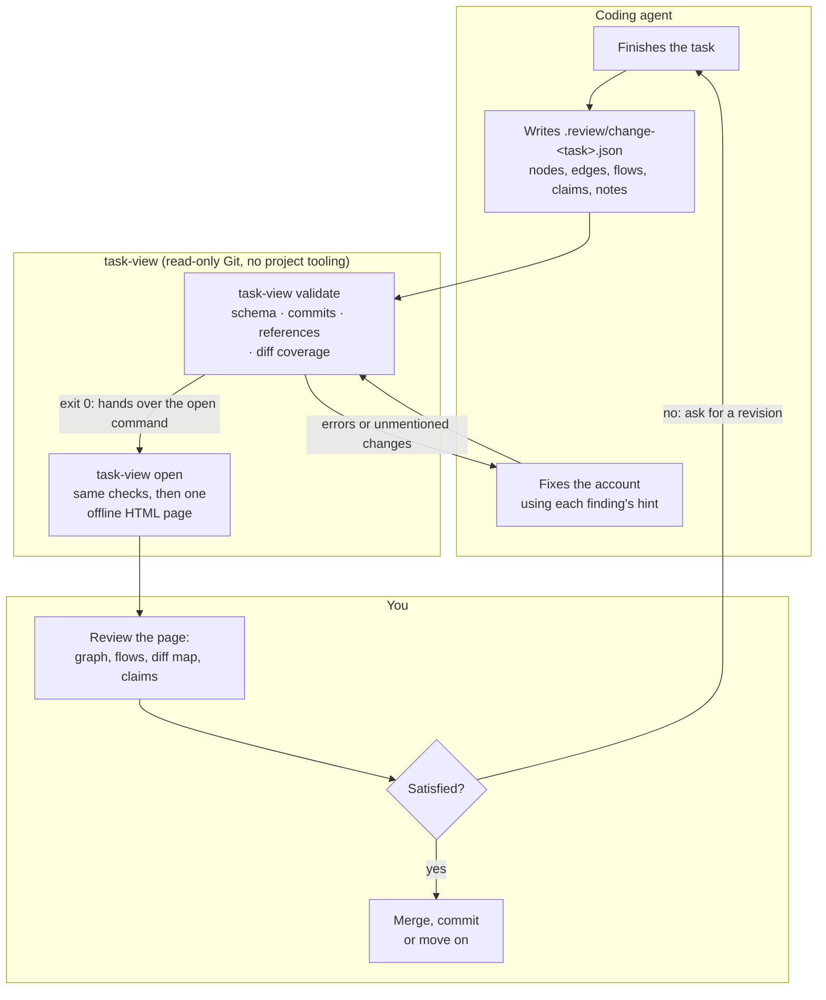

# task-view

**Let a coding agent hand over its work in a form you can actually inspect.**

When a coding agent finishes a task on its own, you usually get a diff and a
confident summary in chat. Checking that the summary is true means reading
the whole diff yourself.

`task-view` changes the handover. When the agent is done, it writes a
structured account of the task: which functions, components and tests it
touched, why, how they connect, and the claims a reviewer might doubt, each
pointing at exact files, lines and commits. `task-view` checks every one of
those references against Git and turns the account into one offline HTML page
where each element is marked **verified**, **contradicted**, **unresolved** or
**the agent's word**.


## What it checks, and what it doesn't

- It checks **the account, not the work.** It confirms that every reference
  resolves, that each node really changed the way the agent says, and that
  every changed line is described by some node. Whether the code is good
  stays your call; the page makes that call faster.
- It is **read-only.** It reads files and runs a short list of read-only Git
  commands. It never runs your tests, builds, linters or any project tooling.
  A test result on the page is always shown as the agent's word.
- It writes **one file**: the HTML page, which works offline and can be kept
  or shared.

## How it works



1. **The agent finishes the task** and writes `.review/change-<task>.json` in
   the repo where the task started. The file lists the repos and commits it
   covers, one node per meaningful piece of the change (a function, a
   component, a config block, a test case), the edges between them, the
   user-visible flows they form, and any claims, each with a reference to
   exact lines or commits.
2. **The agent validates its own account** with
   `task-view validate .review/change-<task>.json --format json`. Every error
   and warning carries a hint written for the agent to act on (a wrong line
   range, a substring not on that line, changed lines no node describes). It
   repeats until the file validates.
3. **You open the review** with `task-view open .review/change-<task>.json`.
   The tool runs the same checks, reads only the repos listed in the file, and
   writes one self-contained page that opens in your browser.
4. **You decide.** If something is off, ask the agent to fix the code or the
   account; it rewrites the same file and `open` gives a fresh page. Each task
   keeps its own file, so earlier reviews stay in `.review/`.

## The page

Every node, edge and piece of evidence is drawn with one of four statuses, the
same way in every view:

| Status | Look | Meaning |
| --- | --- | --- |
| Verified | Solid border, green check | The reference resolved and matches the files and the diff |
| Contradicted | Red border, red ✕ | The reference resolved but the check failed: wrong lines, wrong change state, text not on that line |
| Unresolved | Amber dashed border, ? | The file, line range or commit could not be found |
| Agent statement | Dotted gray border, italic | Nothing to check: no reference, or the agent's own explanation |

The fill shows the change itself: green **added**, blue **modified**, red
**deleted**, outline only for **unchanged**. The side panel always shows the
agent's summary, each repo's commits from base to final state, the findings
and the agent's notes.

The screenshots below are a real review of one commit of this repository,
written by an agent and checked by `task-view`.

### Graph

The whole change at a glance (top of this page): source-code nodes grouped by
repo, endpoints between repos. Tests, docs and unchanged nodes sit behind the
toolbar switches. Search with `/`, click a node to focus on it and its
neighbours.

### Inspector

Click any node, edge, hunk or finding to open it on the right: where it is,
why it changed in the agent's words, which tests cover it, how it relates to
other nodes, and its code. The code box switches between **Diff** (changed
lines with what they replaced) and **After** (the code as it reads after the
change).


### Flows

One lane per user- or caller-visible path through the change, left to right,
with the tests that exercise it hanging under the steps they cover.


### Diff map

Every changed file with a bar of its hunks, colored by whether a node
describes them: green covered, amber partly covered, red not mentioned at
all. This is where you check that nothing was left out.


### Claims

Statements a reviewer might doubt ("the tab survives a reload"), each with the
evidence it rests on. Expand a piece of evidence to see the exact code or
commit it points at.


### When the account is wrong

If the review file still has errors, the page says so in a red banner, and
the findings in the side panel list what does not hold: here an edge that
points at text missing from its line, and changed CSS lines that no node
mentions.


## Install

Download the binary for your machine from the
[latest release](https://github.com/gtindo/task-view/releases/latest):

| Platform | File |
| --- | --- |
| macOS, Apple silicon | `task-view-darwin-arm64` |
| macOS, Intel | `task-view-darwin-amd64` |
| Linux, x86-64 | `task-view-linux-amd64` |
| Linux, ARM64 | `task-view-linux-arm64` |
| Windows, x86-64 | `task-view-windows-amd64.exe` |

Rename it `task-view` (`task-view.exe` on Windows) and put it on your `PATH`;
the [user guide](docs/USER_GUIDE.md#1-install) has the exact commands for each
platform. Or build it with Go:

```bash
go install github.com/gtindo/task-view/cmd/task-view@latest
```

From a checkout, `make install` puts `task-view` in `$(go env GOPATH)/bin`.
The only runtime dependency is `git`.

## Use it with your coding agent

The agent needs to know the review file format and the procedure. Pick one
way to give it that.

### As a skill (recommended)

[`skills/task-review/SKILL.md`](skills/task-review/SKILL.md) is a ready-made
skill. It tells the agent to run `task-view instructions` when it finishes a
task and follow what it prints, so the instructions always match the installed
binary. For Claude Code, copy it into the repo, or into `~/.claude/skills/`
for every repo:

```bash
mkdir -p .claude/skills/task-review
curl -fsSL https://raw.githubusercontent.com/gtindo/task-view/main/skills/task-review/SKILL.md -o .claude/skills/task-review/SKILL.md
```

Any agent that reads skills (a `SKILL.md` with `name` and `description` front
matter) takes the same file. It is also attached to every release.

### As a context file

Write the instructions into the repo and point your agent's context file at
them:

```bash
task-view instructions > TASK_REVIEW.md
```

Then add one line to that repo's `AGENTS.md` (Codex and most agents) or
`CLAUDE.md` (Claude Code):

```markdown
When you finish a task, follow TASK_REVIEW.md.
```

Refresh the file after upgrading `task-view`.

### As a one-off prompt

No setup at all: end your task prompt with

> When you're done, run `task-view instructions` and write a review file for
> this task.

The same works for work that is already committed:

> Run `task-view instructions` and write `.review/change-<name>.json` for
> commit `<sha>`. Don't change any code.

## Guides

| Guide | For | What it covers |
| --- | --- | --- |
| [docs/USER_GUIDE.md](docs/USER_GUIDE.md) | You, the reviewer | Install, daily workflow, reading every part of the page, findings, keyboard, exit codes, troubleshooting |
| [docs/TASK_REVIEW.md](docs/TASK_REVIEW.md) | The agent | The review file format and the step-by-step procedure; the same text `task-view instructions` prints |
| [skills/task-review/SKILL.md](skills/task-review/SKILL.md) | The agent | The procedure packaged as a skill |
| [specs/init.md](specs/init.md) | Contributors | The full specification: schema, checks, findings and views |

## Commands

| Command | What it does |
| --- | --- |
| `task-view validate <file> [--format text\|json] [--scan-siblings]` | Schema, commit chain, reference and diff-level checks. Exit 0 ok, 1 contradicted/unresolved refs, 2 invalid file, 3 environment error |
| `task-view open <file> [--out <path>] [--no-browser] [--scan-siblings]` | Same checks, then writes one offline HTML page (default `generated/<name>.html` next to the review file) and opens it. Exit 1 still renders the page, with a red banner |
| `task-view schema` | JSON Schema of the review file |
| `task-view languages` | Valid language names and their usual file patterns |
| `task-view instructions` | The agent instructions for this binary's schema version |
| `task-view version` | Binary and supported schema versions |

Only the repos listed in the review file are read. `--scan-siblings` also
looks at the folders next to them and warns (`unlisted_repo`) about Git repos
with uncommitted changes that the review doesn't list.

## Development

```bash
make test    # unit tests and golden tests on generated fixture repos
make build   # bin/task-view
make check   # vet, lint (golangci-lint, ESLint via npx) and test
```

Code rules and package boundaries are in [AGENTS.md](AGENTS.md).

Layout: `cmd/task-view` (CLI), `internal/review` (model, embedded JSON
Schema, structural rules), `internal/engine` (Git states, diff, reference and
coverage checks), `internal/render` (view data and the embedded page:
`assets/app.js`, `assets/app.css`, vendored Cytoscape.js + ELK),
`internal/langs` (Chroma lexers and highlighting), `internal/instructions`
(`TASK_REVIEW.md`), `internal/fixture` (test repos), `skills/` (the agent
skill), `docs` (the user guide, screenshots and a copy of `TASK_REVIEW.md`
regenerated by `make docs`).

Golden output for the accurate fixture review lives in
`cmd/task-view/testdata/valid.golden.json`; refresh it with `make golden`.

### Releasing

Releases are built by [`.github/workflows/release.yml`](.github/workflows/release.yml)
only when a version tag is pushed; pushes to `main` never build one. The
workflow runs vet and tests, then `make release` for Linux (amd64, arm64),
Windows (amd64) and macOS (Intel, Apple silicon), and publishes the binaries,
`SHA256SUMS`, the guides and the skill as a GitHub release. Tags with a
suffix (`v0.2.0-rc.1`) are marked as pre-releases.

```bash
git tag v0.2.0
git push origin v0.2.0
```

`make release VERSION=0.2.0` builds the same `release/` folder locally.
